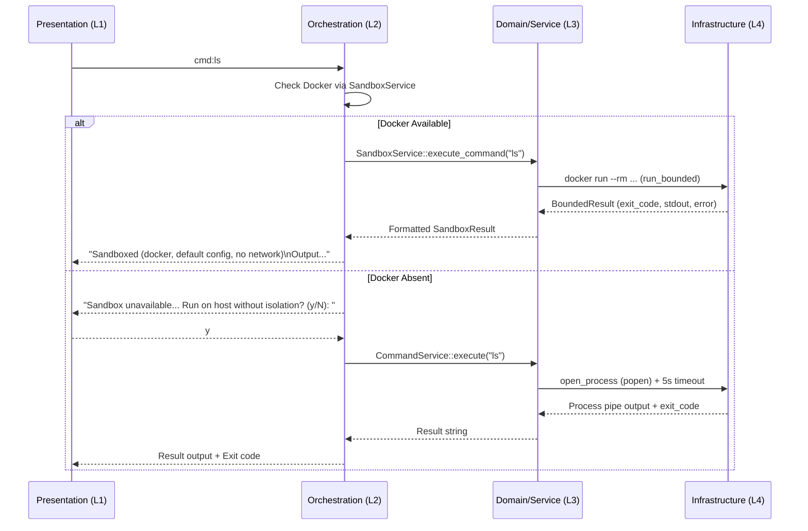

# Layer Architecture Map

**Target:** Agentware v0.2.0 (`aa6c72ee`)
**Audit Model:** 4-Layer Product-Level Architecture with Presentation Return Path
**Audit Date:** 2026-10-11
**Verification Environment:** macOS 27.0.1 (Darwin 26.0.0 arm64), Apple Clang 17.0.0, CMake 3.31.6

---

## 1. Architectural Model Overview

Agentware is structured as a single-binary terminal-native AI agent. The technical audit organizes its concrete implementation across four logical layers:

```mermaid
flowchart TD
    subgraph L1["Layer 1: Presentation Layer"]
        CLI["main.cpp Entry"]
        REPL["Agent::run REPL Loop"]
        UI["Utils::UI (Colors, Tables, Spinner, Prompt)"]
        Parsers["Prefix & Token Parsers (@, !, /, :)"]
    end

    subgraph L2["Layer 2: Application / Orchestration Layer"]
        Agent["Core::Agent (State, Lifecycle, Command Count)"]
        Validator["Utils::Validator (Path, Security, Input Rules)"]
        Router["execute_routed_command (Sandbox vs Host Opt-In)"]
        DirectDispatch["Agent::handle_direct_command"]
        MetaDispatch["Agent::handle_meta_command"]
        ChatDispatch["Agent::handle_ai_chat"]
    end

    subgraph L3["Layer 3: Domain & Service Layer"]
        FileSvc["Services::FileService"]
        MultiFileSvc["Services::MultiFileService"]
        CodebaseSvc["Services::CodebaseService"]
        GitSvc["Services::GitService"]
        GitHubSvc["Services::GitHubService"]
        WebSvc["Services::WebService"]
        ContextSvc["Services::ContextService"]
        CheckpointSvc["Services::CheckpointService"]
        SandboxSvc["Services::SandboxService"]
        MCPSvc["Services::MCPService (Simulation)"]
        AuthSvc["Services::AuthService"]
        ThemeSvc["Services::ThemeService"]
        ErrorSvc["Services::ErrorService"]
        CmdSvc["Services::CommandService"]
        DBSvc["agentware::DatabaseService (Unused)"]
        MemoryMgr["Data::MemoryManager (LRU, Session, Global Facts)"]
        AISvc["Services::AIService"]
    end

    subgraph L4["Layer 4: Infrastructure Layer"]
        LLM["External LLM APIs (OpenAI, Together, Cerebras, Fireworks, Groq, DeepSeek)"]
        Ollama["Local Ollama Daemon (localhost:11434)"]
        Docker["Docker Daemon (CLI /var/run/docker.sock)"]
        OSProcess["OS Process Subsystem (fork/exec, popen)"]
        VFS["Local Filesystem & POSIX IO"]
        NetHTTP["Networking (libcurl, CPR, HTTP/HTTPS)"]
        Crypto["OpenSSL EVP AES-256-GCM / PBKDF2"]
        PersistentStorage["data/*.json, data/memory.txt, ~/.agentware/AGENTWARE.md"]
    end

    %% Flow connections
    L1 --> L2
    L2 --> L3
    L3 --> L4
    L4 -. Results / Exceptions .-> L3
    L3 -. Domain Entities / Formatted Text .-> L2
    L2 -. Output Strings / Warnings .-> L1
```

---

## 2. Concrete Layer Mapping

### Layer 1: Presentation Layer
Responsible for user interface presentation, terminal interaction, logo/banner rendering, help documentation, status indicators, and input capture.

| File / Component | Logical Responsibility | Concrete Role in Agentware |
|---|---|---|
| [`src/main.cpp`](file:///Users/bniladridas/agentware/src/main.cpp) | Entry Point & Top-level Catch | Loads `.env`, outputs logo via `UI::print_logo()`, initializes `Core::Agent`, catches unhandled exceptions. |
| [`src/ui.cpp`](file:///Users/bniladridas/agentware/src/ui.cpp) / [`src/include/ui.h`](file:///Users/bniladridas/agentware/src/include/ui.h) | UI Rendering Utilities | ANSI terminal color codes, Coccinella Labs logo, help menu (`print_help`), spinners, divider bars, ready prompt. |
| [`src/agent.cpp:89-142`](file:///Users/bniladridas/agentware/src/agent.cpp#L89-L142) | REPL Interaction Loop | `Agent::run()` prompts `> `, handles exit/quit, help, version, and forwards input to `process_user_input`. |
| [`src/agent.cpp:144-270`](file:///Users/bniladridas/agentware/src/agent.cpp#L144-L270) | Interactive Mode Setup | Prompts user for Online vs Offline mode, provider selection (1-6) or local model selection (1-3). |
| [`src/agent.cpp:1047-1102`](file:///Users/bniladridas/agentware/src/agent.cpp#L1047-L1102) | Meta Help Menu | Outputs available slash (`/`) commands and tool formats. |
| [`src/agent.cpp:1154-1193`](file:///Users/bniladridas/agentware/src/agent.cpp#L1154-L1193) | Tools Help Menu | Formats available direct tools (`read:`, `write:`, `git:`, `github:`, etc.). |

### Layer 2: Application / Orchestration Layer
Responsible for input categorization, syntax validation, security enforcement, command routing, state transitions, session history recording, and agent loop lifecycle.

| File / Component | Logical Responsibility | Concrete Role in Agentware |
|---|---|---|
| [`src/agent.cpp:272-310`](file:///Users/bniladridas/agentware/src/agent.cpp#L272-L310) | User Input Categorizer | Directs input based on prefix: `@` (injection), `!` (shell), `/` (meta), bare words (`forget`, `memory`, `clear`), `:` (direct), or natural text (AI chat). |
| [`src/agent.cpp:312-747`](file:///Users/bniladridas/agentware/src/agent.cpp#L312-L747) | Direct Tool Dispatcher | Parses colon-separated arguments, applies security checks, invokes domain services, records results to memory. |
| [`src/agent.cpp:749-787`](file:///Users/bniladridas/agentware/src/agent.cpp#L749-L787) | AI Chat Orchestrator | Lazily provisions `AIService`, loads session + hierarchical context, runs background spinner, invokes LLM chat, appends conversation to memory. |
| [`src/agent.cpp:795-819`](file:///Users/bniladridas/agentware/src/agent.cpp#L795-L819) | Shell Routing & Policy | Evaluates Docker availability: routes to `SandboxService` if Docker is active; prompts user for unsandboxed host opt-in (`y/N`) if absent. Denies on `N`/EOF. |
| [`src/agent.cpp:853-915`](file:///Users/bniladridas/agentware/src/agent.cpp#L853-L915) | Meta Command Router | Normalizes bare verbs (appends space), dispatches subcommands to appropriate management handlers. |
| [`src/agent.cpp:48-69`](file:///Users/bniladridas/agentware/src/agent.cpp#L48-L69) | Persistence Fault Boundary | Wraps interaction recording and global facts in try/catch to ensure persistence failures do not terminate REPL session. |
| [`src/validation.cpp`](file:///Users/bniladridas/agentware/src/validation.cpp) / [`src/include/validation.h`](file:///Users/bniladridas/agentware/src/include/validation.h) | Input & Security Validator | Enforces canonical project-root boundary containment (path traversal prevention), safe shell token inspection, strict integer parsing. |

### Layer 3: Domain and Service Layer
Encapsulates business logic, system capability adapters, and domain models. Stateless services provide domain capabilities, while stateful services manage runtime data.

| File / Component | Domain Area | Concrete Implementation Details |
|---|---|---|
| [`src/file_service.cpp`](file:///Users/bniladridas/agentware/src/file_service.cpp) | File Operations | Direct file reading, range reading, atomic/guarded writes, single-line text replacement, directory grep with regex. |
| [`src/multi_file_service.cpp`](file:///Users/bniladridas/agentware/src/multi_file_service.cpp) | Batch Files | Pattern-based recursive file collection, gitignore-aware filtering, multi-file payload collation with size caps. |
| [`src/codebase_service.cpp`](file:///Users/bniladridas/agentware/src/codebase_service.cpp) | Code Intelligence | Project structure analysis, tree visualization, component extraction, TODO/FIXME task scanning. |
| [`src/git_service.cpp`](file:///Users/bniladridas/agentware/src/git_service.cpp) | Version Control | Local Git integration for `git status`, `git log`, repository change metrics. |
| [`src/github_service.cpp`](file:///Users/bniladridas/agentware/src/github_service.cpp) | Remote GitHub | REST API integration for repository stats, issues listing, PR inline review threads with pagination, repository health checks. |
| [`src/web_service.cpp`](file:///Users/bniladridas/agentware/src/web_service.cpp) | Web & HTTP | Web page text extraction, JSON payload fetching, DuckDuckGo search integration via Instant Answer API. |
| [`src/context_service.cpp`](file:///Users/bniladridas/agentware/src/context_service.cpp) | Context Hierarchy | Hierarchical `AGENTWARE.md` discovery, caching, and template generation across directory structures. |
| [`src/checkpoint_service.cpp`](file:///Users/bniladridas/agentware/src/checkpoint_service.cpp) | State Checkpoints | File snapshot creation, checkpoint cataloging in `data/checkpoints/`, full/partial restore mechanisms. |
| [`src/sandbox_service.cpp`](file:///Users/bniladridas/agentware/src/sandbox_service.cpp) | Container Sandbox | Docker container execution manager with memory limits, CPU quotas, capability dropping (`--cap-drop ALL`), network isolation (`--network=none`), bounded runtime. |
| [`src/mcp_service.cpp`](file:///Users/bniladridas/agentware/src/mcp_service.cpp) | Tool Protocol | Server configuration registry in `data/mcp_servers.json`; protocol simulation for resources, tools, and prompts. |
| [`src/auth_service.cpp`](file:///Users/bniladridas/agentware/src/auth_service.cpp) | Credentials Store | Encrypted credential store with AES-256-GCM and PBKDF2 salt derivation in `data/auth_config.json`. |
| [`src/theme_service.cpp`](file:///Users/bniladridas/agentware/src/theme_service.cpp) | UI Theming | Theme persistence in `data/theme_config.json` with primary/accent/error palettes. |
| [`src/error_service.cpp`](file:///Users/bniladridas/agentware/src/error_service.cpp) | Diagnostics | In-memory error logging, validation rules catalog, error summary and export. |
| [`src/command_service.cpp`](file:///Users/bniladridas/agentware/src/command_service.cpp) | Host Process Execution | Subprocess execution with 5-second asynchronous timeout, regex dangerous command filter, 10KB output buffer limit. |
| [`src/memory_manager.cpp`](file:///Users/bniladridas/agentware/src/memory_manager.cpp) | Memory & Conversation | Session context buffering, LRU entry caching, global markdown facts persistence (`~/.agentware/AGENTWARE.md`), AI context compression. |
| [`src/ai_service.cpp`](file:///Users/bniladridas/agentware/src/ai_service.cpp) | LLM Adapter | Standardized JSON payload builder, provider URL switching, SSE streaming reader for Cerebras, Ollama REST adapter. |
| [`src/database_service.cpp`](file:///Users/bniladridas/agentware/src/database_service.cpp) | Relational Database | PostgreSQL client wrapper using `libpqxx`. **Orphaned / Unwired** (no callers). |

### Layer 4: Infrastructure Layer
Handles physical interaction with operating system primitives, networking stacks, container engines, hardware, and persistence files.

| Component / Subsystem | Infrastructure Boundary | Real World Target |
|---|---|---|
| libcurl & CPR | Network Socket / HTTP Stack | External LLM endpoints, GitHub REST API, web servers, DuckDuckGo. |
| Docker CLI (`docker`) | Container Runtime API | Local Docker Engine via `/var/run/docker.sock` to execute ephemeral containers. |
| POSIX Process (`popen`, `execvp`, `fork`) | OS Process Subsystem | Host binary execution for `git`, system commands, shell processes. |
| Local Filesystem & `std::filesystem` | Storage Subsystem | Reading/writing project files, `data/` checkpoints, configs, and memory stores. |
| OpenSSL Crypto Engine (`libcrypto`) | Cryptographic Hardware/Subsystem | `RAND_bytes`, `EVP_CIPHER_CTX`, PBKDF2 key derivation. |
| Local Ollama Daemon | Local LLM Server | HTTP daemon listening at `http://localhost:11434`. |

---

## 3. Presentation Return Path Analysis

A crucial aspect of product-level architecture is whether results, diagnostic details, exit codes, and degradation notices properly traverse back from Layer 4 through Layers 3 and 2 to Layer 1.

### Layer Boundary Violations & Structural Observations
1. **Direct UI Output in Service Layer:**
   - Multiple services directly invoke `std::cout` or `std::cerr` instead of returning structured results (e.g. `SandboxService::print_sandbox_summary()`, `ErrorService::print_error_report()`, `ThemeService::print_theme_preview()`, `MCPService` startup logs).
2. **Dual Theming Systems:**
   - `Utils::UI` uses hardcoded ANSI escape sequences in `Utils::Color` (`PINK`, `GREEN`, `RED`, `CYAN`), while `Services::ThemeService` defines dynamic configurable color maps that are not consumed by the main REPL chrome.
3. **Double Presentation Printing:**
   - In `Agent::run()`, `Utils::UI::print_ready_interface()` prints "Ready - Type a command:\nReady - Type a command or chat naturally:\n" (duplicate lines).
4. **Orphaned Database Domain:**
   - `DatabaseService` lives in a non-standard namespace `agentware::` and is neither instantiated nor referenced anywhere in the orchestration layer.
